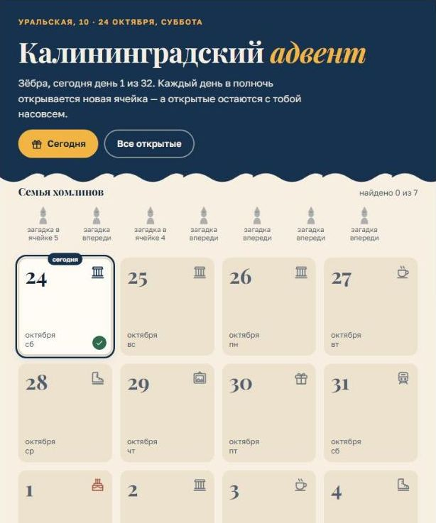
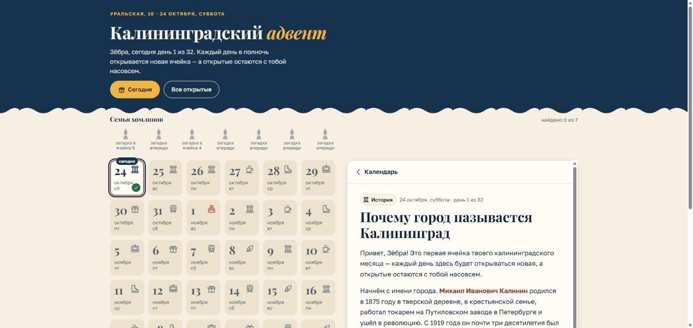

# Калининградский адвент

Адвент-календарь на 32 дня (24.10–24.11.2026) для Зёбры: каждый день в 00:00 по калининградскому времени открывается новая ячейка, открытые остаются доступными навсегда.

Сайт: **https://krokodila888.github.io/kaliningrad/**

| Телефон, 375 px | Планшет, 768 px | Ноутбук, 1440 px |
| --- | --- | --- |
|  |  |  |

## Запуск

Нужен Node.js 20+.

```bash
npm install
npm run dev          # разработка: http://localhost:5173/kaliningrad/
npm test             # тесты (граница суток, данные, шифрование, прогресс)
npm run check-data   # только проверить data/*.json
npm run build        # сборка в dist/ (сначала проверка типов и данных)
npm run preview      # посмотреть собранную версию
```

## Как добавить или поправить ячейку

Код трогать не нужно — только `data/cells.json`.

1. Откройте `data/cells.json` (можно прямо на GitHub: карандаш «Edit this file»).
2. Добавьте объект в массив. Порядок в файле не важен, важно, чтобы `day` и `date` совпадали (день 1 = 2026-10-24, день 9 = 2026-11-01, день 32 = 2026-11-24).
3. Сохраните (commit) в ветку `main` — через ~1,5 минуты сайт обновится сам, у подруги новая версия подтянется при следующем открытии.

Если в данных опечатка (неверная дата, неизвестный тип, лишнее поле, ссылка не на Яндекс Карты), сборка упадёт с понятным сообщением на русском — сайт при этом продолжит показывать прошлую рабочую версию. Посмотреть ошибку: вкладка **Actions** в репозитории.

Минимальная ячейка:

```json
{
  "day": 6,
  "date": "2026-10-29",
  "type": "museum",
  "title": "Биржа, где теперь картины",
  "story": "Три–шесть предложений. Можно **жирный**, *курсив* и [ссылки](https://example.com).\n\nПустая строка — новый абзац.",
  "practical": {}
}
```

Все поля (описание типов — `src/types.ts`, правила проверки — `src/data/schema.ts`):

| Поле | Обязательно | Что это |
| --- | --- | --- |
| `day`, `date` | да | Номер дня 1–32 и дата `ГГГГ-ММ-ДД` |
| `type` | да | `intro` `history` `taste` `route` `museum` `gift` `trip` `slow` `birthday` `finale` — от него иконка и оформление (`birthday` — праздничная тема с конфетти) |
| `title`, `story` | да | Заголовок и история (markdown) |
| `practical` | да (может быть `{}`) | `address`, `hours`, `price`, `distanceFromHome`, `mapUrl` (только `https://yandex.ru/maps…`) |
| `task` | нет | `{ "text": "…", "answer": "…" }` — задание с кнопкой «Сделала!»; ответ показывается после отметки |
| `homlin` | нет | id хомлина из `data/homlins.json` — загадка с кнопкой «Нашла!» |
| `gift` | нет | `{ "title", "description", "link"?, "code"? }` — распаковка подарка |
| `image` | нет | `{ "src": "kant.jpg", "alt": "описание для незрячих" }`, файл кладётся в `public/img/` |
| `events` | нет | До 4 событий дня: `{ "time"?: "18:30", "title", "place", "price"?, "link"? }`. Без `time` — «весь день» |

Для дат без ячейки в сетке показывается иконка по ритму недели (пн — история, вт — вкус, …), а при открытии — «Ячейка ещё упаковывается».

## Режим автора

Откройте сайт с параметром:

```
https://krokodila888.github.io/kaliningrad/?preview=СЕКРЕТ
```

Секрет не хранится в репозитории — в `src/config.ts` лежит только его SHA-256. Появится панель: «все ячейки открыты» и «перемотка» даты (−1 / +1 / выбор дня) — так можно проверить, как календарь выглядит в любой день. Прогресс (прочитано, «Нашла!») в режиме автора сохраняется на вашем устройстве, как у обычного посетителя.

Сменить секрет: `node -e "console.log(require('crypto').createHash('sha256').update('НОВЫЙ').digest('hex'))"` → вставить результат в `PREVIEW_SECRET_HASH`.

## Как устроено

- **Открытие ячеек** — `src/lib/time.ts`: дата считается по `Europe/Kaliningrad` (UTC+2 круглый год) через `Intl`, без привязки к поясу устройства. Тесты границы суток — `tests/time.test.ts`.
- **Данные** — плагин `src/build/adventData.ts` при сборке читает `data/*.json`, проверяет их zod-схемой и кладёт в сборку зашифрованными.
- **Прогресс** — `localStorage` (`kaliningrad-advent:progress:v1`); если хранилище недоступно (приватный режим), всё работает в памяти без ошибок.
- **Офлайн** — PWA (`vite-plugin-pwa`): сайт, шрифты и картинки кэшируются, раз в час и при каждом открытии проверяется новая версия, страница обновляется сама.
- **Адреса** — у каждой ячейки свой: `#day-2026-11-01`, лента — `#all`, бонус хомлинов — `#homlins`.

### Про «шифрование» — честно

Тексты ячеек в собранном JS зашифрованы AES-GCM, ключ = SHA-256(соль + дата ячейки). Соль лежит в той же сборке, поэтому любой, кто откроет DevTools и разберётся в коде, расшифрует всё. Это **защита от случайного подглядывания** («открою исходник и прочитаю, что будет завтра»), а не криптостойкость. Кроме того, репозиторий публичный, и `data/cells.json` в нём лежит открытым текстом — подруге просто не нужно туда заходить. Загадки хомлинов (`data/homlins.json`) не шифруются.

## Деплой

Автоматический: каждый push в `main` запускает `.github/workflows/deploy.yml` (тесты → сборка → GitHub Pages). Вручную: вкладка **Actions** → «Деплой на GitHub Pages» → **Run workflow**.

Первичная настройка (уже сделана): Settings → Pages → Source: **GitHub Actions**. Путь сайта `/kaliningrad/` задан в `vite.config.ts` (`BASE`) — при переименовании репозитория поменяйте его там.

Иконки приложения пересобираются из `public/icon.svg` командой `node scripts/make-icons.mjs`.
